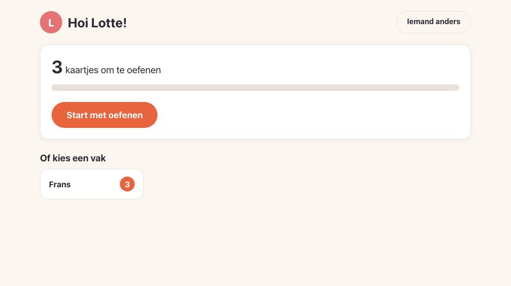
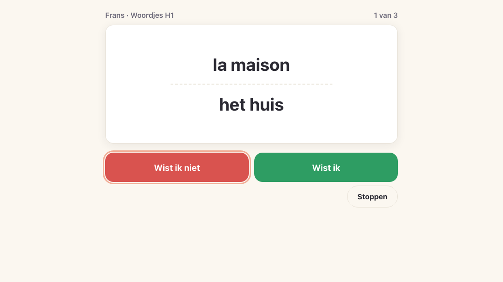
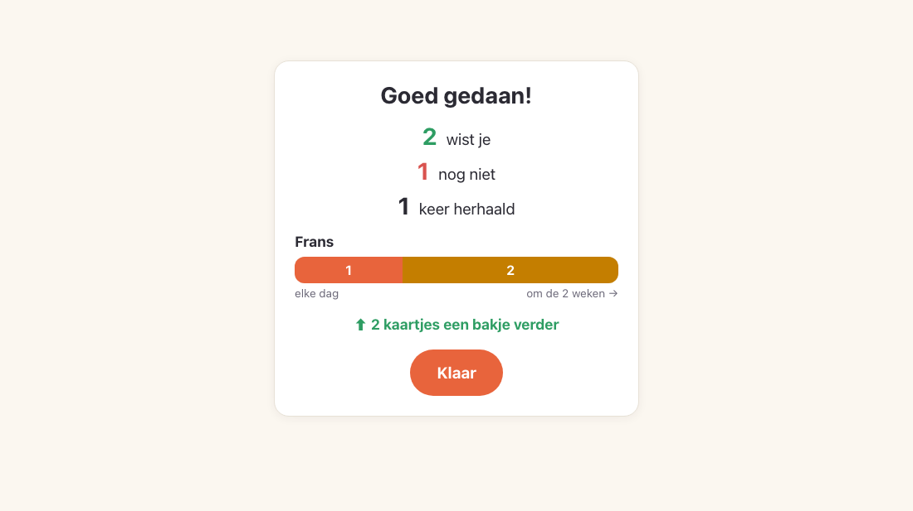
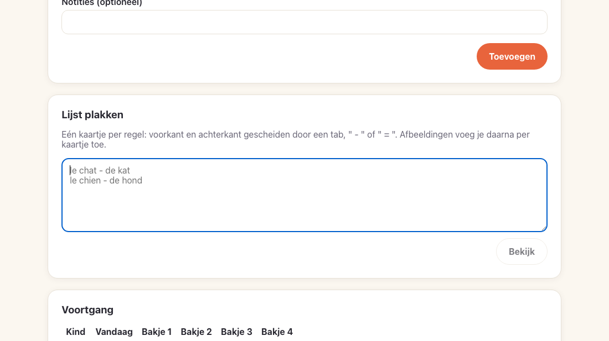

# Wistjet

A simple flashcard app for families, built around the **4-box system** children already use at
school. Each child picks their profile and gets one question answered: *what do I need to practise
today?* Parents add the cards; Wistjet decides which ones come back when.

Wistjet runs on your own computer or home server. No accounts, no cloud, no ads, no tracking.
The app is in Dutch.

| Child home | Studying | Summary | Parent: a deck |
|---|---|---|---|
|  |  |  |  |

## How it works

- **Children** tap their name, see how many cards are due, and study: show the answer, then
  *Wist ik* (I knew it) or *Wist ik niet* (I didn't). Missed cards come back at the end of the
  session. Children never see boxes or dates.
- **Cards move through boxes.** In the school system, box 1 comes back after 1 day, box 2 after 2,
  box 3 after 7, box 4 after 14. Knowing a card moves it up; missing it sends it back to box 1.
  Parents can copy this system and change the boxes and days.
- **Parents**, behind a PIN, add children, subjects and decks, type or paste cards (one per line:
  `le chat - de kat`), add pictures, and see how each child is doing.
- **Backups** are one file you can download and restore, and Wistjet also makes one every day.

> **Keep Wistjet on your home network.** It is made for a family at home: there are no user
> accounts, and children use it without a password. Do not make it reachable from the internet
> (no port forwarding, no public reverse proxy).

## Install

Pick one. All three keep every card, picture and answer in one place that survives upgrades.

### On a computer (Windows, macOS, Linux)

1. Download the file for your computer from the
   [latest release](https://github.com/brightclouds-be/wistjet/releases/latest) and unpack it.
2. Start `wistjet` (`wistjet.exe` on Windows). A window opens with Wistjet's addresses, and your
   browser opens the setup.
   - **Windows** may say it protected your PC: choose *More info*, then *Run anyway*, and allow
     network access so tablets can connect.
   - **macOS** may say `wistjet` is from an unidentified developer: open *System Settings* →
     *Privacy & Security*, choose *Open Anyway* next to the message, and start it again.
3. Keep the window open while you use Wistjet; closing it stops Wistjet.

Your data is in your user's app-data folder (`~/Library/Application Support/Wistjet` on macOS,
`%APPDATA%\Wistjet\data` on Windows, `~/.local/share/wistjet` on Linux).

### With Docker (a NAS or home server)

```sh
docker run -d --name wistjet --restart unless-stopped \
  -p 8080:8080 -v wistjet-data:/data \
  -e WISTJET_PUBLIC_URL=http://192.168.1.10:8080 \
  ghcr.io/brightclouds-be/wistjet:latest
docker logs wistjet   # shows the setup code
```

Or use the [`compose.yaml`](compose.yaml) in this repository: `docker compose up -d`, then
`docker compose logs wistjet`. Replace `192.168.1.10` with your server's address. The image runs
as user id 65532 and works on amd64 and arm64 (Raspberry Pi, most NAS).

Using a folder instead of a named volume (for example `-v /volume1/docker/wistjet:/data` on a
NAS)? Make it writable for Wistjet first: `sudo chown 65532:65532 /volume1/docker/wistjet`.
Otherwise Wistjet can't create its database and keeps restarting. The same goes for a backup
folder.

### On Kubernetes

[`k8s/wistjet.yaml`](k8s/wistjet.yaml) has a volume, a single-pod deployment (Wistjet keeps its data
in one SQLite file, so it must never run twice), a service and an ingress. Put your host name in
its three marked places (`WISTJET_PUBLIC_URL`, `WISTJET_HOSTS` and the ingress host). Then run
`kubectl apply -f k8s/wistjet.yaml`, and `kubectl logs deploy/wistjet` for the setup code.

## First run

The first screen asks for a family name, a PIN for the parent area, your first child, and whether
to add a small French–Dutch sample deck. When you start Wistjet on a computer, the browser it
opens already knows the **setup code**. On any other device, type the code shown in Wistjet's
window or log. This keeps someone else on your network from setting up Wistjet (and its PIN)
before you do.

At the end, a QR code shows the address for **tablets** on the same wifi. Add it to their home
screen.

## Configuration

Wistjet works without any settings. These environment variables change the defaults:

| Variable | Default | What it does |
|---|---|---|
| `WISTJET_DATA_DIR` | your app-data folder (`/data` in Docker) | Where the database lives |
| `WISTJET_PORT` | `8080` | The port Wistjet listens on |
| `WISTJET_PUBLIC_URL` | detected | The address tablets use, shown during setup; set it in Docker and Kubernetes |
| `WISTJET_HOSTS` | (none) | Extra host names that may reach Wistjet, comma-separated (e.g. a reverse-proxy name). IP addresses, `localhost`, single-word names and `.local` names always work |
| `WISTJET_BACKUP_DIR` | `backups` in the data folder | Where daily backups go, e.g. a NAS share |
| `WISTJET_BACKUP_KEEP` | `14` | How many daily backups to keep |
| `WISTJET_OPEN_BROWSER` | `1` (`0` in Docker) | `0` stops Wistjet from opening a browser at start |

## Backups

- **Download a backup:** parent area → *Instellingen* → *Download back-up*. It is one file with
  everything: children, decks, cards, pictures, progress and settings.
- **Restore:** *Instellingen* → *Back-up terugzetten…*. After you confirm, it replaces everything.
  A backup from an older Wistjet works in a newer one. A file that isn't a Wistjet backup is
  refused, and nothing changes.
- **Daily backups:** Wistjet writes `wistjet-YYYY-MM-DD.db` to its backup folder every day and keeps
  the newest 14. Point `WISTJET_BACKUP_DIR` at another disk or a NAS share, so a broken disk doesn't
  take your backups with it.

## Upgrading

Download the new release and start it instead of the old one, or `docker pull` the image and
recreate the container. Wistjet updates its data automatically the first time the new version
starts. To be safe, download a backup before you upgrade.

## Development

You need Rust (stable) and Node 22.

```sh
npm --prefix web ci && npm --prefix web run build   # the web app, embedded in the binary
cargo run                                            # http://localhost:8080
npm --prefix web run dev                             # UI with hot reload, API from cargo run
```

Checks, as run by CI:

```sh
cargo fmt --check && cargo clippy --all-targets -- -D warnings && cargo test
npm --prefix web run check && npm --prefix web test
cargo build --release && node e2e/e2e.mjs target/release/wistjet   # needs Chrome
```

`SCREENSHOTS=docs/images node e2e/e2e.mjs target/release/wistjet` also refreshes the screenshots
above. The design and the plans it was built from are in [`docs/superpowers`](docs/superpowers).

To release, push a version tag (`git tag v0.1.0 && git push origin v0.1.0`). The release workflow
builds the downloads and the Docker image. A tag with a hyphen (`v0.2.0-rc1`) becomes a pre-release
and doesn't move `latest`. After the very first release, make the image public: on GitHub, open
the `wistjet` package, then *Package settings* → *Change visibility* → *Public*. New packages are
private, so `docker pull` fails for everyone else until you do.

## License

Wistjet is free software under the [GNU Affero General Public License v3.0](LICENSE). You may use,
change and share it. If you run a changed version for others over a network, you must offer them
its source code.
